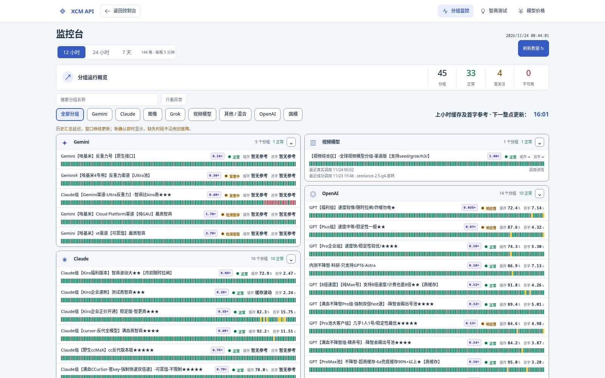

# 当接口和爬虫都不行时：浏览器取证流程

上游取数失败时，先分清是**哪一种**失败。四种失败的处理方式完全不同，
用错工具会白忙一天。

## 第一步：判定失败类型（不要急着开浏览器）

```bash
curl -sS -o /tmp/body -w '%{http_code} %{content_type}\n' -A '<正常 UA>' <url>
head -c 300 /tmp/body
```

| 现象 | 判定 | 浏览器有用吗 |
|---|---|---|
| `403` + HTML 里含 `Sorry, you have been blocked` / `Attention Required! \| Cloudflare` | **网络层封锁**（整站或整 IP） | ❌ 没用。这是 IP/ASN 级封禁，不是 JS 挑战 |
| `403` + `Error 1010: Access denied` + 提到 `browser's signature` | **客户端指纹封禁** | ⚠️ 换真实浏览器 UA 可能过，也可能不过 |
| `401/403` + JSON `AUTH_UNAUTHORIZED` | **接口鉴权**，模块没对外开放 | ✅ 登录后可以 |
| `200` 但 HTML 里没有目标数字 | **JS 渲染**（SPA） | ✅ 渲染后 DOM 里有 |
| `200` + HTML 里有数字 | **服务端渲染** | 不需要浏览器，直接 scrape |

判定依据要看**响应体**，不能只看状态码。`200` 返回 SPA 首页是常态，
`403` 也可能是 Cloudflare 的整站封禁而不是缺 token。

## 第二步：浏览器渲染并取证

用**完整 Chromium**，不要用 headless shell——后者更容易被指纹识别，
而且部分页面在 shell 下渲染不全。

```python
from playwright.sync_api import sync_playwright

with sync_playwright() as p:
    browser = p.chromium.launch(
        headless=True,
        executable_path="~/.cache/ms-playwright/chromium-<ver>/chrome-linux64/chrome",
        args=["--no-sandbox", "--disable-blink-features=AutomationControlled"],
    )
    ctx = browser.new_context(
        user_agent="Mozilla/5.0 (Windows NT 10.0; Win64; x64) AppleWebKit/537.36 "
                   "(KHTML, like Gecko) Chrome/131.0.0.0 Safari/537.36",
        viewport={"width": 1600, "height": 1000},
        locale="zh-CN",
    )
    page = ctx.new_page()
    calls = []
    page.on("response", lambda r: calls.append((r.status, r.url)) if "/api/" in r.url else None)

    page.goto(url, wait_until="domcontentloaded", timeout=60000)
    page.wait_for_timeout(8000)          # 等 XHR 回来，不是等 load
    page.screenshot(path="shot.png")

    print(page.title(), page.url)
    print(page.inner_text("body")[:2000])
    print(calls[:20])                     # 顺手记下它自己调了哪些接口
    browser.close()
```

**关键：先看 `inner_text` 和网络请求，再看截图。**

`page.on("response")` 这一步价值很高：它经常直接暴露真正的数据接口，
把「浏览器方案」降级成「一个之前没发现的公开 API」。比如 xcmapi 的监控页
表面是渲染出来的，实际数据来自 `/jk/status.json`，抓那个 JSON 比渲染页面
稳定得多。

## 第三步：三种结局与对应动作

### A. 页面渲染出数据了 → 取值并写成 spec

优先级：**DOM 文本 > 接口 JSON > 截图**。

```python
rows = page.eval_on_selector_all(
    ".group-row",
    """els => els.map(e => ({
        key: e.querySelector(".group-name").innerText.trim(),
        values: {
            rate: e.querySelector(".rate").innerText.trim(),
            cache: e.querySelector(".cache").innerText.trim(),
        },
    }))""",
)
```

拿到的行写进 `specs/<host>.json` 的 `browser` 档（见 `references/specs.md`）。
先用 `--only <渠道id>` 单跑一个渠道确认。

### B. 停在登录页 → 一次性人工登录换 storage_state

**不让 agent 碰密码。** 由用户本人在有显示器的机器上跑一次：

```python
with sync_playwright() as p:
    b = p.chromium.launch(headless=False)
    ctx = b.new_context()
    page = ctx.new_page()
    page.goto("https://<host>/login")
    input("登录完成后按回车...")
    ctx.storage_state(path=f"{Path.home()}/.config/<skill>/state/<host>.json")
    b.close()
```

然后 `chmod 600` 那个文件。它等价于密码：不进仓库、不贴给 agent、不进日志。

### C. 整站被封 → 换出口，不是换浏览器

`Sorry, you have been blocked` 是 Cloudflare 在 IP/ASN 层拒绝，浏览器指纹
怎么改都没用。可行的只有：

1. 换出口 IP（住宅代理/另一台机器），并且别再触发风控；
2. 找站主要白名单；
3. 放弃这一家的自动采集，退回本站真实请求。

**不要**尝试无头浏览器隐身军备竞赛——那是持续的维护负担，而且封号风险
落在业务账号上。

## 第四步：截图到底怎么用

截图是**取证与审计**工具，不是主数据源。

| 用途 | 合适吗 |
|---|---|
| 人工确认「页面长什么样、有没有数据」 | ✅ 最直接 |
| 告警时附一张现场图 | ✅ |
| 判断页面是登录墙还是渲染完成 | ✅ |
| 从截图 OCR 出价格/成功率写进库 | ❌ |

为什么不让截图当主数据源：

- **不可校验**。`54.17` 被读成 `54.7`，没有任何断言能发现；而 DOM 取值
  可以校验结构、类型、范围。
- **没有结构**。同一屏里哪个数字属于哪个模型，全靠版面推断，改版即错。
- **不可复现**。同一页面两次截图可能因动画/懒加载不同，无法回归测试。

所以流程是：**截图用来判断「能不能取」，DOM/JSON 用来「取」。**

## 第五步：把结论写回覆盖率表

每家上游在 `references/coverage.md` 里记一行：走法、实测结果、失败原因。
失败原因要具体到「哪一层」——`Cloudflare 整站封禁` 和 `模块未开放`
是两种完全不同的待办。

## 实测样本（2026-11-24）

| 站点 | `curl` 结果 | 浏览器结果 | 结论 |
|---|---|---|---|
| xcmapi.org `/jk/#monitor` | 200，HTML 是 3.4MB 壳 | 渲染正常，读到 45 个分组、各档倍率、缓存率、首字 | 数据其实来自公开 `/jk/status.json`，直接抓 JSON 更好 |
| pub.els.edu.rs `/pricing` | 401 `AUTH_UNAUTHORIZED` | 能打开，**重定向到登录页** | 登录墙，需要 storage_state |
| beiluoxi.top | 403 Cloudflare | **`Sorry, you have been blocked`** | 整站 IP 封禁，浏览器无用 |

这三条正好对应 A/B/C 三种结局，可以当模板套到新上游上。

xcmapi 监控页渲染后的样子（说明「页面确实有数据」时的形态）：



## 登录环节：先分清「流程问题」还是「凭证问题」

登录失败时不要反复调选择器——先直接打一次登录接口，看服务端到底怎么说：

```python
res = page.evaluate("""async (p) => {
  const r = await fetch('/api/user/login', {
    method: 'POST',
    headers: {'Content-Type': 'application/json'},
    body: JSON.stringify(p)
  });
  return {status: r.status, body: (await r.text()).slice(0, 200)};
}""", {"username": user, "password": password})
```

判读：

| 返回 | 含义 | 下一步 |
|---|---|---|
| `success: true` | 凭证有效，问题在 UI 交互 | 再修选择器/勾选/按钮 |
| `用户名或密码错误，或用户已被封禁` | **凭证或账号状态问题** | 停手，让人确认账号；继续试选择器是浪费 |
| `需要验证码` / `requires_2fa` | 有人在防自动化 | 走人工登录换 storage_state |
| `429` / 频繁失败 | 触发风控 | 立刻停，等冷却，别加重封禁 |

这一步能省掉大量无用功。UI 上「点了没反应」经常不是脚本的错，是服务端
已经拒绝了，只是前端没把错误显示出来。

## 登录表单的常见交互坑

- **条款勾选**：new-api 系的登录页要求勾「我已阅读并同意」，未勾时提交按钮
  `disabled`。而且它常是 Radix/Base-UI 的 `span[role=checkbox]` 包一个隐藏
  `input`，点 `input` 无效，要点 `span[role=checkbox]`。
- **按钮被遮挡**：弹层容器会 `intercepts pointer events`。优先用
  `page.click('button[type="submit"]')` 配合先滚动到视图内；仍失败时直接走
  接口登录，再回填 cookie。
- **等 load 不等于等渲染**：SPA 用 `wait_until="networkidle"`，之后再加
  2–4 秒给前端 hydration。

## 凭证卫生（每次都要做）

- 凭证写进 `umask 077` 的临时文件，跑完 `rm`。
- 任何输出都不打印 password 字段；错误信息里如果有回显，先脱敏。
- `storage_state.json` 等价于登录态，权限 600，同样跑完即删或存进
  `~/.config/<skill>/state/`。
- 不把凭证写进技能目录、仓库、或不含 `.gitignore` 的任何地方。


### Playwright 过不了 Turnstile，nodriver 可以

实测同一台机器、同一个站点：

| 引擎 | 结果 |
|---|---|
| Playwright（无头 / 有头 / Xvfb / CDP 派发事件 / 持久化 profile） | 控件停在「请验证您是真人」，从不进入验证，10 分钟无 token |
| **nodriver**（`pip install nodriver`） | **点击后约 24 秒拿到 token** |

原因：Playwright 走 CDP，会泄漏 `Runtime.enable` 等特征，Turnstile 专门检测这个；
nodriver 用另一套附加方式，指纹干净得多。

所以需要过验证的站点，用：

```bash
python3 scripts/export_with_login.py --host <上游域名> \
  --login-url https://<上游域名>/sign-in --out out/models.json
```

它内部就是 nodriver：等验证 → 填账号密码 → 提交 → 用 CDP Network 事件截下
应用自己发出的 `Authorization` 头 → 调 `/api/pricing` 与
`/api/perf-metrics/summary` → 输出 `upstream-model-catalog/v1`。

前提：`pip install nodriver`，且系统里有 Chromium（脚本会自动找
`~/.cache/ms-playwright/chromium-*/chrome-linux64/chrome`）。
无显示器时用 `xvfb-run -a -s "-screen 0 1920x1080x24"` 包一层。

## 人机验证（Cloudflare Turnstile）

这类站点**不要让 agent 去登**，也不要试图绕过——那是站点专门用来区分人和
机器的，绕过既不稳定也不合适（实测：无头/有头/Xvfb/CDP 派发鼠标事件全部
被判定为自动化，控件显示「卡住? 故障排除」）。

正确处理：**人只做那一次验证，之后全部自动化。**

1. 你本人在浏览器里登录（人机验证你自己点）；
2. F12 → Console → 粘贴 `scripts/browser_export.js` → 回车；
3. 浏览器下载 `upstream-models-<host>.json`，格式见 `model-export-json.md`。

这一步是**在已登录的页面里跑脚本**，不涉及任何验证绕过：会话是你自己的，
脚本只是替你把 `/api/pricing` 和 `/api/perf-metrics/summary` 的数据合并导出。

如果要长期无人值守：把浏览器登录态导出成 `state/<host>.json`
（`login_upstream.py --manual` 就是干这个的），之后用
`export_upstream_model_json.py --state ...` 定时跑，直到 cookie 过期再手动续一次。

### 判断是不是这类站点

- 登录页出现 `cf-turnstile-response` 隐藏字段 → Turnstile
- 控件显示「请验证您是真人」且点击后长时间停在「正在验证…」→ 自动化被识别
- 页面在任何请求前就要求过验证 → 没有免登录出口
